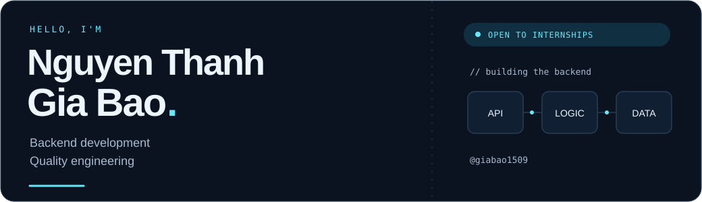
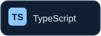
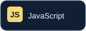
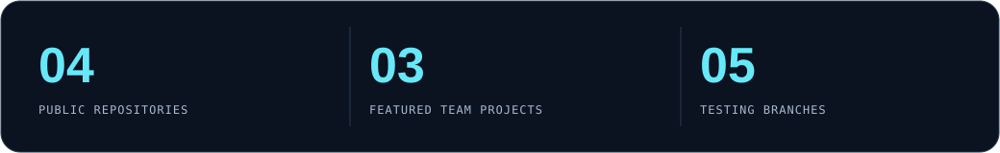

<picture>
  <source media="(prefers-color-scheme: dark)" srcset="assets/header-dark.svg">
  <source media="(prefers-color-scheme: light)" srcset="assets/header-light.svg">
  
</picture>

  <b>Backend Developer Internship</b> &nbsp; / &nbsp; Information Technology Student

  <a href="#about-me">About</a> &nbsp; · &nbsp;
  <a href="#tech-stack">Stack</a> &nbsp; · &nbsp;
  <a href="#featured-projects">Projects</a> &nbsp; · &nbsp;
  <a href="#github-statistics">Activity</a> &nbsp; · &nbsp;
  <a href="mailto:giabao.150905@gmail.com">Contact</a>

## About Me

I'm **Nguyen Thanh Gia Bao**, a fourth-year Information Technology student at **University of Science, VNU-HCM**, expecting to graduate in **July 2027**.

I'm seeking a **Backend Developer internship**, with interests in **Software Engineering** and **Quality Engineering**. My project work spans REST APIs, database-backed workflows, authentication, and software testing.

- **Backend focus:** Node.js, TypeScript, REST APIs, and SQL; Java and Spring Boot through team projects.
- **Quality mindset:** test design, browser automation, API testing, and performance testing through coursework.
- **What I'm looking for:** an opportunity to build useful backend services, learn from code reviews, and contribute to a team.

## Tech Stack

  
  
  
  
  
  

| Context | Technologies used |
| :--- | :--- |
| Backend projects | Express, Prisma, PostgreSQL, Redis, BullMQ, Java, Spring Boot |
| Testing coursework | Playwright, Postman, Newman, Apache JMeter |
| Development tools | Git, GitHub, Docker Compose |

## Featured Projects

### 01 / UniHub Workshop

**Workshop registration, payments, and check-in** · Team project

A TypeScript monorepo with a web app, mobile check-in app, REST API, and background workers.

**My contributions:** payment and student CSV import workflows, plus check-in and notification fixes.

Node.js · TypeScript · Express · Prisma · PostgreSQL · Redis · BullMQ

[Repository](https://github.com/khoadanwneee/Software-Design) &nbsp; / &nbsp; [Payment & CSV implementation](https://github.com/khoadanwneee/Software-Design/commit/abb6e6f3a4837576b2f01bab993fc75c8336a83b) &nbsp; / &nbsp; [My commits](https://github.com/khoadanwneee/Software-Design/commits?author=giabao1509)

---

### 02 / AidBridge

**Disaster relief coordination** · Team project

An Android and Spring Boot application connecting people requesting aid, volunteers, sponsors, and relief hubs.

**My contributions:** aid/SOS, hub, and donation APIs; asynchronous mission-event handling; and donation-flow integration in the Android app.

Java · Spring Boot · PostgreSQL · Android

[Repository](https://github.com/phatnguyen975/AidBridge) &nbsp; / &nbsp; [Donation API implementation](https://github.com/phatnguyen975/AidBridge/commit/3e54018f549b464c330b6fd8909ef16f87fd2723) &nbsp; / &nbsp; [My commits](https://github.com/phatnguyen975/AidBridge/commits?author=giabao1509)

---

### 03 / GenDA · SkillBridge

**Contributor and SME collaboration platform** · Team project, in development

A Next.js frontend and Spring Boot modular monolith. Current backend functionality includes authentication, contributor profiles, and read-only skill/project catalogs.

**My contributions:** registration, login/logout, email OTP verification, and skill/project browsing APIs.

Java · Spring Boot · PostgreSQL · Next.js · Docker Compose

[Repository](https://github.com/KidCute1412/GenDA) &nbsp; / &nbsp; [Email OTP implementation](https://github.com/KidCute1412/GenDA/commit/cb4b2b3e6b4b3d28139e13792139bee8320d043e) &nbsp; / &nbsp; [My commits](https://github.com/KidCute1412/GenDA/commits?author=giabao1509)

---

### 04 / EShop · Quality Engineering Coursework

**Testing an existing e-commerce system** · Individual homework in a shared repository

My work here focuses on testing the supplied application. The branches below contain my coursework and supporting artifacts.

| Coursework | Focus | Evidence |
| :--- | :--- | :--- |
| HW2 | Test design, including state transitions and use cases | [HW2-Bao](https://github.com/trngnneee/eshop-sut/tree/HW2-Bao) |
| HW3 | GUI checklists, usability evaluation, cross-browser testing | [HW3-Bao](https://github.com/trngnneee/eshop-sut/tree/HW3-Bao) |
| HW4 | Browser test automation with Playwright | [HW4-Bao](https://github.com/trngnneee/eshop-sut/tree/HW4-Bao) |
| HW5 | Load, stress, and spike testing with Apache JMeter | [HW5-Bao](https://github.com/trngnneee/eshop-sut/tree/HW5-Bao) |
| HW6 | API testing with Postman and Newman | [HW6-Bao](https://github.com/trngnneee/eshop-sut/tree/HW6-Bao) |

## GitHub Statistics

<picture>
  <source media="(prefers-color-scheme: dark)" srcset="assets/statistics-dark.svg">
  <source media="(prefers-color-scheme: light)" srcset="assets/statistics-light.svg">
  
</picture>

Snapshot: 24 October 2026. Public repository count comes from GitHub; project and branch counts refer to the work featured above. These cards are stored locally and do not update automatically.

[View current contributions](https://github.com/giabao1509?tab=overview) &nbsp; / &nbsp; [Browse public repositories](https://github.com/giabao1509?tab=repositories)

## Contact

Interested in discussing a **Backend Developer internship**? I'd be happy to connect.

**Email:** [giabao.150905@gmail.com](mailto:giabao.150905@gmail.com) 
**GitHub:** [@giabao1509](https://github.com/giabao1509)
